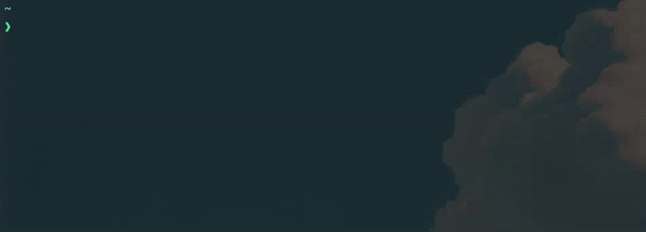

# Sandbox
Monitor and Manage processes in a controlled environment.
### Requirements
- Linux
- g++
- make
- POSIX libraries 

### Quick setup

##### Compilation
```bash
git clone https://github.com/miguelandin/sandbox.git
cd sandbox/
make
```

##### Usage
```bin
# In the the root dir of the project
./bin/sandbox <flags> <bin_route>
```

##### Example
